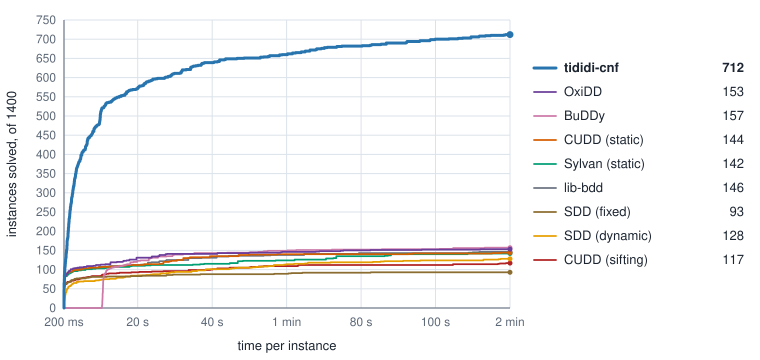
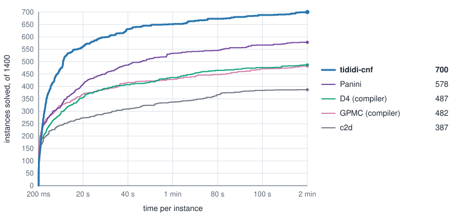

<p align="center">
  
</p>

<p align="center">
  <a href="https://tractables.github.io/tididi-cnf/"></a>
  <a href="https://github.com/Tractables/tididi-cnf/actions/workflows/rust.yml"></a>
  <a href="https://tractables.github.io/tididi-cnf/tididi_cnf/"></a>
  <a href="LICENSE"></a>
</p>

**Compile CNF formulas into reusable Tree Decision Diagrams.**

tididi-cnf compiles DIMACS CNF into canonical circuits you can save, combine
with constraints and query under new evidence or literal weights. It supports
model counting, weighted counting and projected counting.

Built on [vitri](https://github.com/Tractables/vitri) and
[tididi](https://github.com/Tractables/tididi).
[Try it in your browser](https://tractables.github.io/tididi-cnf/) or read
[*A Canonical Generalization of OBDD*](https://arxiv.org/abs/2604.05537).

## How well does it work?

All primary comparisons cover the full MCC 2020–2026 track-1 sets:
1,400 entries, 1,153 distinct formulas, two minutes per instance.
Both compiler plots use the same saved and validated tididi-cnf results.
[Methods and full results](docs/evaluation.md).

### Compared with bottom-up decision-diagram compilers

<p align="center">
  
</p>

BDD variable orders and initial SDD vtrees use FORCE, with
[documented fallbacks](docs/evaluation.md#bottom-up-decision-diagram-compilation).
CUDD is shown both with and without dynamic variable-order sifting.

### Compared with logic-circuit compilers

tididi-cnf compiles the most instances in this comparison.

<p align="center">
  
</p>

[Results and method](docs/evaluation.md#logic-circuit-compilation).

### Compared with model counters

Compared with the exact entries in the 2026
[Model Counting Competition](https://mccompetition.org/).

<p align="center">
  
</p>

[Results and method](docs/evaluation.md#model-counting-two-minutes).

<details>
<summary>One-hour model counting results</summary>

The 100 private MCC 2026 instances, with one hour per instance.

<p align="center">
  
</p>

[Results and method](docs/evaluation.md#one-hour).

</details>

[Explore the interactive plots](https://tractables.github.io/tididi-cnf/evaluation/).

## Build

Requires Linux, Rust and a C++20 toolchain; see the
[build prerequisites](docs/building.md).

```sh
git clone https://github.com/Tractables/tididi-cnf
cd tididi-cnf
cargo build --release
```

## Command line

```sh
./target/release/tididi tests/data/mcc_mc_sat.cnf
```

Output:

```text
model count: 22
```

[Getting started](docs/getting-started.md) covers compilation and counting.
See [tasks](docs/tasks.md), [input format](docs/input.md) and
[time and memory limits](docs/limits.md) for the options.

## Library

```rust
use tididi_cnf::{count, parse_dimacs, Limits, Mode};

let formula = parse_dimacs("p cnf 3 3\n1 2 0\n-1 3 0\n-2 -3 0\n".as_bytes())?;
let answer = count(formula, Some(Mode::Mc), &Limits::default())?;
println!("Models: {}", answer.count());
```

Output:

```text
Models: 2
```

[Rust API](https://tractables.github.io/tididi-cnf/tididi_cnf/) ·
[Worked examples](https://tractables.github.io/tididi-cnf/tididi_cnf/guide/examples/index.html) ·
[Use from another Rust crate](docs/building.md#use-from-another-rust-crate)

Bindings: [Python](bindings/python/README.md), [C](bindings/c/README.md)
and [WebAssembly](bindings/wasm/README.md).

## License and citation

Apache License 2.0 ([LICENSE](LICENSE), [NOTICE](NOTICE)).
Citation details are in [CITATION.cff](CITATION.cff).
See [contributing](.github/CONTRIBUTING.md) and the [changelog](docs/changelog.md) for development.

## Acknowledgements

This material is based upon work supported by the Defense Advanced Research
Projects Agency (DARPA) under Agreement No. HR0011269E224.
