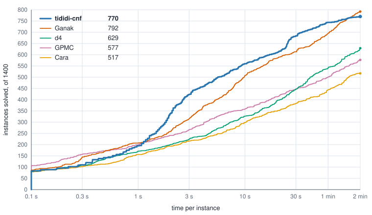
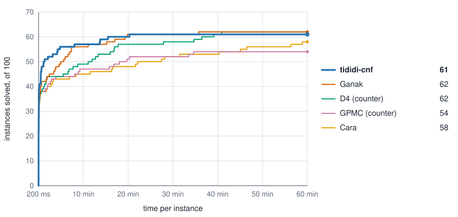

<p align="center">
  
</p>

<p align="center">
  <a href="https://tractables.github.io/tididi-cnf/"></a>
  <a href="https://github.com/Tractables/tididi-cnf/actions/workflows/rust.yml"></a>
  <a href="https://tractables.github.io/tididi-cnf/tididi_cnf/"></a>
  <a href="LICENSE"></a>
</p>

**Count the solutions of a CNF formula exactly, or compile it into a circuit
you can query.**

tididi-cnf reads a propositional formula in DIMACS CNF and answers how many
assignments satisfy it, optionally weighted and optionally counted over a
chosen subset of the variables. It gets there by compiling the formula into a
**Tree Decision Diagram** (TDD), a canonical circuit on which counting takes
one pass. Where an OBDD tests variables in one fixed order, a TDD follows a
*vtree*, a binary tree over the variables. TDDs are introduced in
[*A Canonical Generalization of OBDD*](https://arxiv.org/abs/2604.05537).

The compiler simplifies the formula and chooses the vtree with
[vitri](https://github.com/Tractables/vitri), and builds the diagram with the
[tididi](https://github.com/Tractables/tididi) library. It is a command-line
tool, `tididi`, and a Rust library, `tididi_cnf`.

## Evaluation

tididi-cnf and the exact counters entered in the 2026
[Model Counting Competition](https://mccompetition.org/) ran on all 1,400
track-1 entries from 2020–2026, two minutes per instance, on the same machine
under the same limits. Every competition entry is included; repeated formulas
use one fixed representative for every solver.

<p align="center">
  
</p>

<!-- evaluation table: generated from docs/evaluation/mcc-track1-2020-2026-120s.csv -->

| Solver | MCC 2020 (200) | MCC 2021 (200) | MCC 2022 (200) | MCC 2023 (200) | MCC 2024 (200) | MCC 2025 (200) | MCC 2026 public (100) | MCC 2026 private (100) | All (1400) |
| --- | ---: | ---: | ---: | ---: | ---: | ---: | ---: | ---: | ---: |
| tididi-cnf | **144** | 91 | 134 | 124 | **82** | 82 | 60 | **53** | 770 |
| Ganak | 142 | **102** | **141** | **129** | 81 | **87** | **61** | 49 | **792** |
| d4 | 123 | 66 | 123 | 94 | 61 | 65 | 53 | 44 | 629 |
| GPMC | 93 | 58 | 123 | 94 | 60 | 56 | 53 | 40 | 577 |
| Cara | 90 | 36 | 110 | 83 | 53 | 54 | 52 | 39 | 517 |

<!-- end of evaluation table -->

As a compiler, writing a circuit that can be queried afterwards,
tididi-cnf compiles 181 of the 400 instances from 2025 and 2026 in two
minutes each. Of four d-DNNF compilers run beside it, Panini compiles 149,
D4v2 143, GPMC 131
and c2d 105, and from three seconds on, tididi-cnf compiles the most within
any time limit:

<p align="center">
  
</p>

<details>
<summary>One-hour model counting results</summary>

The competition's main track allows an hour per instance. Run the same way
for an hour each on the 100 private instances of 2026, tididi-cnf solves
at least as many
instances as any of them within any time limit from three seconds to 18 minutes;
over the full hour, d4 and Ganak solve 62, tididi-cnf 61, Cara 58 and
GPMC 54:

<p align="center">
  
</p>

Given an hour, tididi-cnf also solves 120 of the 200 instances of 2025 and
69 of the 100 public ones of 2026.

</details>

The [evaluation](docs/evaluation.md) documents the measured source snapshot,
formula selection and limits. It includes the separate 2025–2026 comparison,
the one-hour results and every measured run. The
[evaluation page](https://tractables.github.io/tididi-cnf/evaluation/)
opens with the full-corpus two-minute comparison and lets you inspect results
by set, by pair of solvers and by instance.

## What it answers

**Model counting.** How many assignments satisfy the formula: the valid
configurations of a product whose options constrain one another, say. The
[configuration example] counts a laptop shop's offer and then counts again as
a customer chooses.

**Weighted model counting.** The total weight of those assignments, each
weighing the product of its literals' weights. When the weights are
probabilities, the count is the probability that the formula holds. The
[reliability example] computes how likely a network with failing links still
connects two sites.

**Projected counting.** The same questions asked of some of the variables
only: each assignment to them counts once if the rest of the formula can be
completed. An encoding's auxiliary variables stay out of the count this way.
The [circuit example] counts the distinct products a multiplier outputs.

**Compilation.** The TDD itself, saved to a file that the tididi library reads
back and queries: counts under evidence, weighted evaluation, conjunction with
further constraints.

## Build

The binary builds and runs on Linux only, and
[`bindings/wasm`](bindings/wasm/README.md) builds the library for
WebAssembly. Besides Rust, the build needs a C++20 compiler, CMake,
`pkg-config` and the GMP, MPFR and zlib development packages;
[docs/building.md](docs/building.md) lists them. The diagram library and
vitri are git submodules:

```sh
git clone --recurse-submodules https://github.com/Tractables/tididi-cnf
cd tididi-cnf
cargo build --release
```

The binary is `target/release/tididi`.

## Command line

```sh
./target/release/tididi tests/data/mcc_mc_sat.cnf
```

Output:

```text
model count: 22
```

The file is Example 1 of the model counting competition's input format: six
variables, four clauses, and a `c t mc` line that asks for the model count.
Progress goes to stderr; the answer is the one line on stdout.
[Getting started](docs/getting-started.md) works the count out by hand and
then asks the other questions of the same formula.

Its four clauses compile to the diagram below, drawn over its vtree, the
pale tree behind it. Each node is the disjunction of its pairs, a pair the
conjunction of its two halves, and • the node its line leads to. Beside each
node is its number of models: a pair multiplies its halves and a node adds
its pairs, 22 at the top.

<p align="center">
  
</p>

A run answers one task. The instance's header lines name it, as the
competition's format has them, and `--mode` can name it too; the two must
agree.

| task | header lines | flag | answer line |
|---|---|---|---|
| model count | `c t mc` | `--mode mc` | `model count: 22` |
| weighted model count | `c t wmc`, `c p weight` | `--mode wmc` | `weighted count: 3.2999999999999985e0` |
| projected model count | `c t pmc`, `c p show` | `--mode pmc` | `projected model count: 3` |
| projected weighted model count | `c t pwmc`, `c p show`, `c p weight` | `--mode pwmc` | `projected weighted count: 22/25` |
| compilation | none | `--mode compile` | `model count: 22` |

Every count is exact except the weighted model count, which runs in
double-precision arithmetic: 3.3 prints as `3.2999999999999985e0`.
`--save-tdd <file>` writes the compiled circuit, `--stats <path>` a JSON
record of the run, and `tididi --help` lists every flag.

Larger instances are in our collection
[Tractables/cnfs](https://github.com/Tractables/cnfs), which holds the
[model counting competition](https://mccompetition.org)'s instances by year
and track as `.cnf.xz`; decompress one before a run.
[Running many instances](docs/limits.md#many-instances) says how to count a
directory of them side by side.

## Library

This program counts the models of (x1 ∨ x2) ∧ (¬x1 ∨ x3) ∧ (¬x2 ∨ ¬x3),
given as DIMACS text:

```rust
use tididi_cnf::{count, parse_dimacs, Limits, Mode};

let formula = parse_dimacs("p cnf 3 3\n1 2 0\n-1 3 0\n-2 -3 0\n".as_bytes())?;
let answer = count(formula, Some(Mode::Mc), &Limits::default())?;
println!("Models: {}", answer.count());
```

Output:

```text
Models: 2
```

[`count`] runs what the binary runs: preprocessing, vtree selection,
compilation and the fallbacks for an instance that runs out of time or memory.
Below it, [`compile_cnf`] compiles a formula on a vtree you choose; the
[vtree example] compares the circuits several vtrees give. A program that
builds its formula as data passes the clauses to [`formula_from_clauses`]
instead of writing DIMACS text. The crate is not on crates.io yet;
[use it through git](docs/building.md#use-from-another-rust-crate), with the
dependency settings shown in the building guide.

## Bindings

The same counts are available through [Python](bindings/python/README.md)
and [C](bindings/c/README.md), from DIMACS text or from clauses held as data,
and through [WebAssembly](bindings/wasm/README.md) from DIMACS text. The
WebAssembly build runs
[in the browser](https://tractables.github.io/tididi-cnf/), where the
compile of a small formula can be watched step by step and its diagram
asked for each variable's probability under evidence.

## Documentation

- [Worked examples] and the [API reference], with the
  [architecture reference] for contributors.
- The command-line guide: [getting started](docs/getting-started.md), the
  [tasks](docs/tasks.md), the [input format](docs/input.md), the
  [output](docs/output.md), [time and memory limits](docs/limits.md), the
  [run record](docs/stats.md) and the [environment variables](docs/env.md).
- Vtree construction and preprocessing are documented with
  [vitri](https://github.com/Tractables/vitri), the diagrams with
  [tididi](https://github.com/Tractables/tididi).
- [Building](docs/building.md) and [contributing](CONTRIBUTING.md).

To browse the documentation locally, run
`DOCS_RS=1 cargo doc --no-deps -p tididi-cnf --open`; it needs none of the
C++ toolchain ([building](docs/building.md#documentation-builds)).

## Citing

TDDs were introduced in the following paper; [`CITATION.cff`](CITATION.cff)
cites it for this software.

```bibtex
@article{capelli2026canonical,
  title   = {A Canonical Generalization of {OBDD}},
  author  = {Capelli, Florent and Choi, YooJung and Mengel, Stefan and
             Mu{\~n}oz, Mart{\'i}n and Van den Broeck, Guy},
  journal = {arXiv preprint arXiv:2604.05537},
  year    = {2026},
  doi     = {10.48550/arXiv.2604.05537}
}
```

## License

Apache License, Version 2.0 ([LICENSE](LICENSE)). [NOTICE](NOTICE) lists the
components the build includes and where their licences are, among them the
C++ solvers vitri vendors.

[`count`]: https://tractables.github.io/tididi-cnf/tididi_cnf/fn.count.html
[`compile_cnf`]: https://tractables.github.io/tididi-cnf/tididi_cnf/compile/fn.compile_cnf.html
[`formula_from_clauses`]: https://tractables.github.io/tididi-cnf/tididi_cnf/fn.formula_from_clauses.html
[configuration example]: https://tractables.github.io/tididi-cnf/tididi_cnf/guide/examples/catalog/index.html
[reliability example]: https://tractables.github.io/tididi-cnf/tididi_cnf/guide/examples/reliability/index.html
[circuit example]: https://tractables.github.io/tididi-cnf/tididi_cnf/guide/examples/circuits/index.html
[vtree example]: https://tractables.github.io/tididi-cnf/tididi_cnf/guide/examples/vtree_choice/index.html
[Worked examples]: https://tractables.github.io/tididi-cnf/tididi_cnf/guide/examples/index.html
[API reference]: https://tractables.github.io/tididi-cnf/tididi_cnf/
[architecture reference]: https://tractables.github.io/tididi-cnf/tididi_cnf/guide/architecture/index.html
