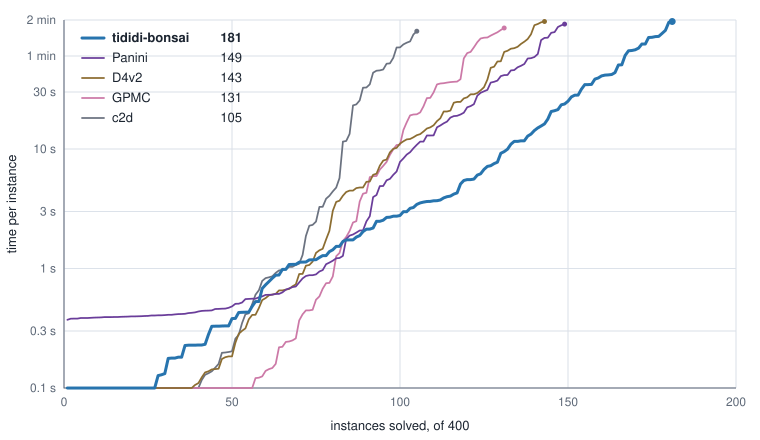
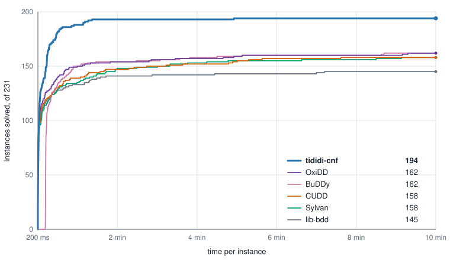
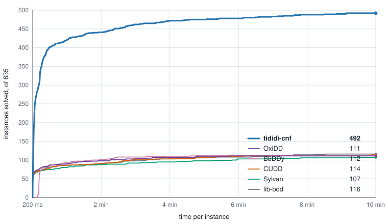

# Evaluation

The [evaluation in the README](../README.md#how-well-does-it-work) compares
tididi-cnf first with logic-circuit compilers, then model counters.
Both primary comparisons use every MCC
2020–2026 track-1 entry: 1,400 entries representing 1,153 distinct formulas,
with the same representative input for every tool and 120 s per instance.
The September experiments and the original 2025–2026 comparison remain
supplements. The one-hour comparison covers the 100 private entries of 2026.

The per-instance results are available as CSV:

- [Logic-circuit compilation, 2020–2026, two minutes](evaluation/mcc-track1-2020-2026-logic-compile-120s.csv).
- [Model counting, 2020–2026, two minutes](evaluation/mcc-track1-2020-2026-120s.csv).
- [Model counting, 2026 private, one hour](evaluation/mcc-track1-3600s.csv).

Supplementary CSVs:

- [Decision-diagram compilation, CNF2BDD-Bench, ten minutes](evaluation/cnf2bdd-2026-09-600s.csv).
- [Decision-diagram compilation, original MCC cohort, ten minutes](evaluation/mcc-cohort-2026-09-600s.csv).
- [Logic-circuit compilation, 2025–2026, two minutes](evaluation/mcc-track1-compile-120s.csv).
- [Model counting, 2025–2026, two minutes](evaluation/mcc-track1-120s.csv).

Each file gives the set, instance, solver, whether it finished and its elapsed
time. The [evaluation page](https://tractables.github.io/tididi-cnf/evaluation/)
opens with logic-circuit compilation. It reads the files listed
in [`evaluation/datasets.json`](evaluation/datasets.json), and its source is
beside them.

The cactus plots put time per instance on the horizontal axis (logarithmic,
starting at 200 ms)
and instances solved within that time on the vertical axis. Higher is better;
each curve continues to the time limit so its final height shows its total.

The primary measurements use the
[0.1.0 evaluation snapshot](https://github.com/Tractables/tididi-cnf/tree/f8acdab8ae4f5becee2c8996905b844f17331efd),
including its recorded dependency revisions. The logic-circuit and counting
comparisons extend the original measurements with the same binary and
settings. These are not new measurements of later release commits.
The September supplements measure an earlier development snapshot. Compare
tools within each comparison: their source and machine are recorded separately.

The labels “D4 (compiler)” and “D4 (counter)” distinguish the task being
measured; GPMC is labelled the same way. Compilation uses the repository
builds and modes below; counting uses the competition's submitted binaries
and scripts. tididi-cnf uses `--mode compile` and `--mode mc`, respectively.

## Instances

Each competition from 2020 through 2025 has 200 track-1 instances. The 2026
competition published 100 in advance and scored the entries on 100 others,
which it published afterwards; the tables call these the public and private
sets. Every competition set is counted in full. No solvability filter is
applied to the two-minute comparison.

The 1,400 entries contain 1,153 distinct formulas. Formula identity uses the
signed clause multiset, declared variable count and task directives, ignoring
comments and clause or literal ordering. Each formula has one representative
input for all solvers. Selection prefers an already measured input and then
the first competition key; it does not depend on solve outcomes. Repeated
entries take that input's result, including its time, and retain their places
in each competition set's denominator.

The separate 2025–2026 comparison below retains its original representative
inputs: ten repeated entries take their twins' results. The full-corpus
comparison reuses those measurements for 381 formulas and measures the
remaining 772 formulas with the same binary, machine type, limits and worker
count.

## Logic-circuit compilation

With `--mode compile`, tididi-cnf writes the diagram it compiles, which
the tididi library reads back and queries. Four d-DNNF compilers, whose
circuits can be queried in the same ways, ran beside it on the same 1,400
entries, two minutes each, side by side (9 runs of each at a time, 45 in
all) on the same kind of machine under the same memory limit:

- tididi-cnf 0.1.0, as
  `tididi --mode compile --save-tdd <file> --time-limit-ms 120000 --mem-limit-mb 61440 <instance>`,
  on the instance without its `c t mc` line, since compilation takes no task.
- [Panini](https://github.com/meelgroup/KCBox),
  [D4](https://github.com/crillab/d4v2) and
  [GPMC](https://github.com/System-Verification-Lab/GPMC), built from their
  repositories' main branches, GPMC in its d-DNNF mode with variable
  elimination off so that its circuit keeps every variable, and
  [c2d](http://reasoning.cs.ucla.edu/c2d/) 2.20.

An instance is compiled when the compiler wrote its circuit within the time
and a separate checker, reading the circuit back, found that it accounts for
every variable, including documented free or fixed variables, and that its
model count is the one the compiler reported. An UNSAT answer represents the
constant-false circuit and is accepted without reading a circuit file.
D4 in compilation mode reports no count, so its time is its own run, without
the check. On one instance of 2025, Panini's circuit and count differ from
the count of tididi-cnf and of Ganak; it counts as not compiled there.
On the one-variable tautology `mc2020_track1_000`, Panini reports two
models but its circuit reads back as one; this validation failure also
counts as not compiled.
c2d exits with SIGSEGV on `mc2020_track1_000` and `mc2026_track1_125`
(2026 public). On `mc2020_track1_089`, `mc2020_track1_121` and
`mc2020_track1_168`, its circuit and self-reported counts agree with each
other but differ from tididi-cnf compiling and counting, Ganak, D4 and Cara.
These invocations count as not compiled.

Compiled counts are also compared with stored model-counting results and
other compilers wherever these supply a count. Validation checks variable
coverage and agreement of the available counts.

The [README comparison](../README.md#compared-with-logic-circuit-compilers)
shows the cactus plot. The per-set compilation totals are:

<!-- evaluation table: generated from docs/evaluation/mcc-track1-2020-2026-logic-compile-120s.csv -->

| Solver | MCC 2020 (200) | MCC 2021 (200) | MCC 2022 (200) | MCC 2023 (200) | MCC 2024 (200) | MCC 2025 (200) | MCC 2026 public (100) | MCC 2026 private (100) | All (1400) |
| --- | ---: | ---: | ---: | ---: | ---: | ---: | ---: | ---: | ---: |
| tididi-cnf | **130** | **85** | **116** | **115** | **73** | **73** | **59** | **49** | **700** |
| Panini | 112 | 60 | 98 | 102 | 57 | 55 | 53 | 41 | 578 |
| D4 (compiler) | 59 | 56 | 98 | 79 | 52 | 48 | 55 | 40 | 487 |
| GPMC (compiler) | 84 | 50 | 92 | 76 | 49 | 48 | 50 | 33 | 482 |
| c2d | 79 | 44 | 66 | 57 | 36 | 30 | 44 | 31 | 387 |

<!-- end of evaluation table -->

### Original 2025–2026 compilation supplement

The original comparison covers all 400 entries with its original input
representatives. It is retained separately from the full-corpus comparison.

  

<!-- evaluation table: generated from docs/evaluation/mcc-track1-compile-120s.csv -->

| Solver | MCC 2025 (200) | MCC 2026 public (100) | MCC 2026 private (100) | All (400) |
| --- | ---: | ---: | ---: | ---: |
| tididi-cnf | **73** | **59** | **49** | **181** |
| Panini | 55 | 53 | 41 | 149 |
| D4 (compiler) | 48 | 55 | 40 | 143 |
| GPMC (compiler) | 48 | 50 | 33 | 131 |
| c2d | 30 | 44 | 31 | 105 |

<!-- end of evaluation table -->

## Model-counting solvers

- tididi-cnf 0.1.0, as
  `tididi --mode mc --time-limit-ms 120000 --mem-limit-mb 61440 <instance>`:
  its defaults, told the time and memory the run has
  ([time and memory limits](limits.md)).
- The 2026 competition's entries in its exact category, as submitted, each
  run by its own script for the track of the run: Ganak, which entered one
  configuration for two minutes and another for an hour, and D4, GPMC and
  Cara, which entered one script for both. The entries in the approximate and
  heuristic categories do not promise exact counts and are left out.

## Machine and limits

The model-counting and logic-circuit comparisons ran on an AWS
`r7i.24xlarge` machine (48 cores, 768 GiB). The
two-minute counts ran 24 at a time, one solver after another. Each run had
120 s of wall-clock time and a 60 GiB address-space limit; the competition
allowed 120 s of CPU time and 62,000 MiB. An instance is solved when the
solver printed its count within the time. Every count agrees with the count of
each other solver that finished the instance and, on the private set, with the
competition's.

Cara's submitted wrapper fails on `mc2023_track1_052`: the multiplier it
passes from Arjun to Cara exceeds the operating system's argument limit.
That invocation counts as unsolved. The submitted scripts and binaries are
unchanged.

## Recent competition sets, two minutes

This separate comparison covers the 400 entries from 2025 and 2026 with its
original representative inputs. It remains available on the evaluation page.

<!-- evaluation table: generated from docs/evaluation/mcc-track1-120s.csv -->

| Solver | MCC 2025 (200) | MCC 2026 public (100) | MCC 2026 private (100) | All (400) |
| --- | ---: | ---: | ---: | ---: |
| tididi-cnf | 82 | 60 | **53** | 195 |
| Ganak | **87** | **61** | 49 | **197** |
| D4 (counter) | 65 | 53 | 44 | 162 |
| GPMC (counter) | 56 | 53 | 40 | 149 |
| Cara | 54 | 52 | 39 | 145 |

<!-- end of evaluation table -->

## One hour

The competition's main track, track 1, allows an hour per instance. On the
100 private instances, the five solvers ran for an hour each on the same kind
of machine under the same limits, side by side: 8 runs of each at a time, 40
in all, so that every solver ran under the same load. An instance that no
entry in the exact category solved in either track of the competition, and
that tididi-cnf had not solved in an hour before, was not run again and
counts as unsolved for every solver; that leaves 67 of the 100 to run.

<!-- evaluation table: generated from docs/evaluation/mcc-track1-3600s.csv -->

| Solver | MCC 2026 private (100) |
| --- | ---: |
| tididi-cnf | 61 |
| Ganak | **62** |
| D4 (counter) | **62** |
| GPMC (counter) | 54 |
| Cara | 58 |

<!-- end of evaluation table -->

Given an hour on its own (48 runs at a time, a 30,000 MiB address-space
limit), tididi-cnf solves 120 of the 200 instances of 2025 and 69 of the
100 public instances of 2026.

## The competition's own results

The 2026 competition ran its entries on its own cluster and published the
[results](https://mccompetition.org/assets/files/2026/MC2026_awards.pdf). An
earlier version of this compiler took part as TiDiDi. On the 100 private
instances, the entries in the exact category solved, in two minutes (track
1F) and in an hour (track 1):

| Solver | 120 s | 3600 s |
| --- | ---: | ---: |
| D4 (counter) | 42 | **63** |
| Ganak | **48** | 62 |
| Cara | 38 | 59 |
| GPMC (counter) | 38 | 57 |
| TiDiDi | 46 | 56 |

Its machines and ours differ, so these numbers and the ones above do not
compare one to one: on ours, D4 solves one instance fewer in an hour, Cara
one and GPMC three, and tididi-cnf 0.1.0 solves 53 of these instances in
120 s and 61 in an hour.

## September decision-diagram supplements

The September comparison uses all 231 files in the model-counting family of
the [OxiDD STTT artifact](https://zenodo.org/records/13923989). These are
MCC 2020–2023 formulas selected by CNF2BDD-Bench's authors using a D4 runtime
filter, preprocessed with pmc and supplied with MINCE variable and clause
orders. This is the full benchmark family, including files omitted from the
artifact's BDD run; it is a selected subset of MCC, not the full competition
corpus.

Five BDD packages run through
[bdd-benchmark](https://github.com/SSoelvsten/bdd-benchmark/tree/3c521e16ada406d37ae5f960096a567a41df33b9)
at its pinned revision. They conjoin clauses in a balanced tree using the
file's static order, without dynamic reordering. CUDD 3.0.0 plus 20 commits
(`538810a`), OxiDD 0.11.2 (`9158645e`) and Sylvan 1.9.0 (`8ddb68e3`) use
complement edges; BuDDy (`5aca063a`) and lib-bdd-ffi (`0c9481b4`) do not.
These are the versions measured, rather than a comparison of current releases.
The September tididi-cnf snapshot runs its default compilation pipeline,
including its own simplification and vtree selection.

All tools have 600 s wall time, one CPU, a 60 GiB tool memory budget, a
64 GiB address-space cap and a 1 GiB stack. The machine is an AWS
`r7i.48xlarge`, with two Xeon Platinum 8488C CPUs, 96 physical cores and
1.5 TiB RAM. This suite runs 32 jobs concurrently, sharing the machine with
another experiment, about 75 jobs in total, in a fixed shuffled order.
Package heaps use transparent huge pages, as in the published setup.

Time is measured from process launch to exit: parsing, initialization and
construction, plus simplification, vtree construction and counting for
tididi-cnf. Diagrams are materialized in memory; file serialization is not
required. A package finishes when it exits successfully and reports its final
BDD size. The TDD run must also report a materialized diagram, including
constant true or false. The complement-edge packages agree on node count on
all 161 formulas where at least two finish; the plain BDD packages agree on
all 144 jointly compiled formulas. These size checks are not an equivalence
proof or independent model-count validation. One run per tool and formula
was measured, so timings near the limit are subject to run variation.

  

<!-- evaluation table: generated from docs/evaluation/cnf2bdd-2026-09-600s.csv -->

| Solver | CNF2BDD-Bench MCC family (231) |
| --- | ---: |
| tididi-cnf | **194** |
| OxiDD | 162 |
| BuDDy | 162 |
| CUDD | 158 |
| Sylvan | 158 |
| lib-bdd | 145 |

<!-- end of evaluation table -->

### Original competition CNF cohort

A separate September comparison reruns a selected cohort of 635 original
MCC 2020–2026 CNFs. The cohort comes from an earlier campaign's solvable
working list where the TDD pipeline exported an input and order; it is not
the full MCC corpus. All 635 are included here, without removing the 28
formulas omitted as trivial in that campaign's report.

The packages use FORCE orders, with the original variable numbering for the
one formula where order construction did not finish. Their input CNFs are
not preprocessed; tididi-cnf still runs its own simplification. Limits and
tool versions match the comparison above. The work is split by formula:
535 on the shared `r7i.48xlarge` at 40 jobs concurrently, and 100 on a
dedicated `r7i.24xlarge` at 16 jobs concurrently. Every tool for a formula runs
on the same machine. Both machines use Xeon Platinum 8488C CPUs and the
compiler sources are identical; timings between the machines are not
calibrated. Order preparation for the packages is outside their measured time.

  

<!-- evaluation table: generated from docs/evaluation/mcc-cohort-2026-09-600s.csv -->

| Solver | Original MCC cohort (635) |
| --- | ---: |
| tididi-cnf | **492** |
| OxiDD | 111 |
| BuDDy | 112 |
| CUDD | 114 |
| Sylvan | 107 |
| lib-bdd | 116 |

<!-- end of evaluation table -->

The compiler binary SHA-256 is
`25ce614740d85433e4e591f452534391b3fe24f189eb3742392a914d93094d04`
on the first machine. The second machine's binary is built from the same
compiler sources. These historical results are kept separate from the
release measurements above.
