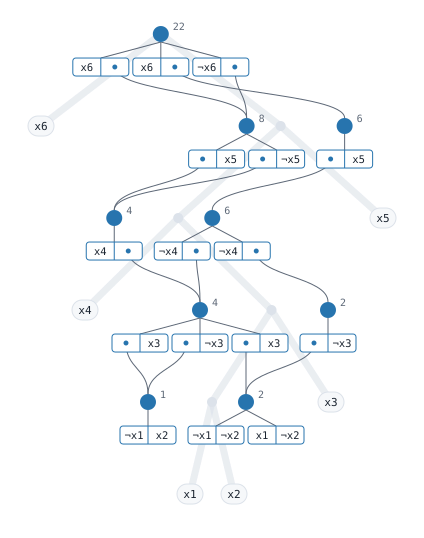

# Count the settings of six switches

This walkthrough states a small problem, works its answers out by hand, and
then has `tididi` compute them: how many solutions there are, how many
settings of two chosen switches a solution can have, the chance that a random
setting of those two can be completed, and a weighted count. It ends by
compiling the formula into a circuit and saving it.

Build the binary first, as the [README](../README.md#build) says. The commands
run from the repository root.

## The problem

Six switches, x1 to x6, are each on or off, under four rules:

1. x1 and x2 are not both on.
2. If x4 is on, then x2 or x3 is on.
3. x4 or x5 is on.
4. x4 or x6 is on.

How many of the 64 settings obey all four?

If x4 is on, rules 3 and 4 hold whatever x5 and x6 are, which leaves 4
choices for those two. Rule 2 needs x2 or x3: with x2 on, rule 1 turns x1 off
and x3 is free (2 settings); with x2 off, x3 must be on and x1 is free
(2 more). That is 4 × 4 = 16. If x4 is off, rule 2 holds, rules 3 and 4 turn
x5 and x6 on, rule 1 allows three of the four settings of x1 and x2, and x3 is
free: 3 × 2 = 6. The answer is **16 + 6 = 22**.

## The formula

In CNF each rule is a clause, and variable *i* is true when switch x*i* is
on. `tests/data/mcc_mc_sat.cnf` is this formula; it is Example 1 of the model
counting competition's input format:

```text
c The data format's Example 1 (MC format v1.2 §4): 22 models.
p cnf 6 4
c t mc
-1 -2 0
2 3 -4 0
4 5 0
4 6 0
```

`p cnf 6 4` declares six variables and four clauses, and each clause line
ends in `0`: `-1 -2 0` is "not x1 or not x2", rule 1. The `c t mc` line asks
for the model count. [`input.md`](input.md) has the whole format.

## Count it

```sh
./target/release/tididi tests/data/mcc_mc_sat.cnf
```

Output:

```text
model count: 22
```

The answer is the one line on stdout. The lines on stderr report progress;
[`output.md`](output.md#stderr) says what they are for.

## Count the settings of two switches

Say only x1 and x2 matter: they are the inputs you set, and the other switches
follow. How many settings of x1 and x2 can be completed to a setting that
obeys every rule? Both on breaks rule 1; each of the other three occurs in the
solutions counted above. The answer is **3**.

That is a projected model count. A `c p show` line names the variables to
count over, and `c t pmc` asks for the count.
`tests/data/mcc_pmc_sat.cnf` is the same formula with those two lines, as in
the competition format's Example 4:

```text
c t pmc
c p show 1 2 0
```

```sh
./target/release/tididi tests/data/mcc_pmc_sat.cnf
```

Output:

```text
projected model count: 3
```

## Weigh them

Now let x1 be on with probability 0.4 and x2 with probability 0.3, each on
its own. What is the chance that the setting they get can be completed? Add
the probabilities of the three settings that can be:

| x1 | x2 | probability |
|---|---|---|
| off | off | 0.6 × 0.7 = 0.42 |
| off | on | 0.6 × 0.3 = 0.18 |
| on | off | 0.4 × 0.7 = 0.28 |

The answer is **0.88**, or 22/25. That is a projected weighted count: a
`c p weight` line gives each literal of a shown variable its weight, and
`c t pwmc` asks for the count. `tests/data/mcc_pwmc_sat.cnf` has these header
lines:

```text
c t pwmc
c p show 1 2 0
c p weight 1 0.4 0
c p weight -1 0.6 0
c p weight 2 0.3 0
c p weight -2 0.7 0
```

```sh
./target/release/tididi tests/data/mcc_pwmc_sat.cnf
```

Output:

```text
projected weighted count: 22/25
```

The projected weighted count is exact, so it prints as a fraction.

## A weighted model count

Without a show line, a weighted count adds up the weight of every solution,
each the product of its literals' weights. `tests/data/wmc_header_tiny_sat.cnf`
has one clause, x1 or x2 or x3, with x1 weighing 3/10 when true and 7/10 when
false, and x2 and x3 weighing 1 either way:

```text
c t wmc
p cnf 3 1
c p weight 1 3/10 0
c p weight -1 7/10 0
c p weight 2 1 0
c p weight -2 1 0
c p weight 3 1 0
c p weight -3 1 0
1 2 3 0
```

The eight settings weigh 1 × 2 × 2 = 4 in all, and the one setting that breaks
the clause, all three false, weighs 7/10. The answer is **3.3**.

```sh
./target/release/tididi tests/data/wmc_header_tiny_sat.cnf
```

Output:

```text
weighted count: 3.2999999999999985e0
```

The weighted model count runs in double-precision arithmetic, so its last
digits carry rounding error. [`tasks.md`](tasks.md) says which task counts in
which arithmetic.

## Compile for later queries

Without a `c t` line, `tididi` compiles the formula into a Tree Decision
Diagram and prints its model count; `--save-tdd` writes the diagram to a
file. Strip the comment lines from the first file to get the four rules alone,
and compile them:

```sh
grep -v '^c' tests/data/mcc_mc_sat.cnf > switches.cnf
./target/release/tididi --save-tdd switches.tdd switches.cnf
```

Output:

```text
model count: 22
tdd written to switches.tdd, vtree to switches.tdd.vtree: 9 nodes, 16 pairs
```

`switches.tdd` is the circuit and `switches.tdd.vtree` the vtree it follows;
[`output.md`](output.md#the-saved-circuit) shows how to read the two back
with the tididi library. Drawn, with the vtree as the pale tree behind it,
the nine nodes count 22 at the top: each pair multiplies the counts of its
two halves, and each node adds its pairs.

<p align="center">
  
</p>

The [browser page](https://tractables.github.io/tididi-bonsai/) draws the
diagram of any small formula this way and shows its compile step by step.

## Your own problem

Replace the file with your DIMACS formula. Name the task with a `c t` line, or
with `--mode` ([`tasks.md`](tasks.md)). On a formula that may be hard, set a
time limit and check the memory limit ([`limits.md`](limits.md)):

```sh
./target/release/tididi --time-limit-ms 600000 formula.cnf
```

A run that runs out of time or memory prints no answer and exits with
status 1.

## From C or Python

The library has C and Python bindings, built from this repository: each call
reads a formula, as DIMACS text, from a file or as clauses of DIMACS integers
the program built, counts it in a mode under a time and a memory limit, and
returns the mode, whether the formula has a model, the count and the run's
record. It is the run `tididi` makes on the same formula and mode. In Python:

```python
import tididi_bonsai

answer = tididi_bonsai.count_file("tests/data/mcc_mc_sat.cnf")
print(answer.mode, answer.count)  # mc 22
answer = tididi_bonsai.count([[1, 2], [-1, 3], [-2, -3]], mode="mc")
print(answer.count)  # 2
```

[`bindings/python/README.md`](../bindings/python/README.md) covers building
the Python extension, and [`bindings/c/README.md`](../bindings/c/README.md)
building and linking the C library.

## In the browser

[The tididi-bonsai page](https://tractables.github.io/tididi-bonsai/) runs the
library in the browser tab, built for WebAssembly: paste or open a formula, or
pick an example, and it counts it as `tididi` would, under the task the
formula declares or one picked on the page, with an optional time limit, and
shows the run's record.
[`bindings/wasm/README.md`](../bindings/wasm/README.md) covers building and
serving the page.
